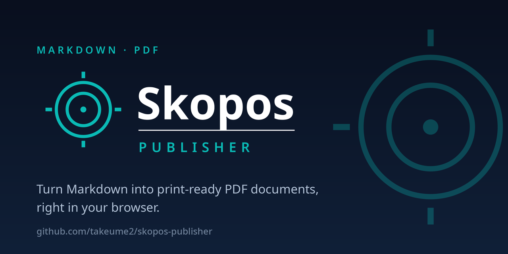
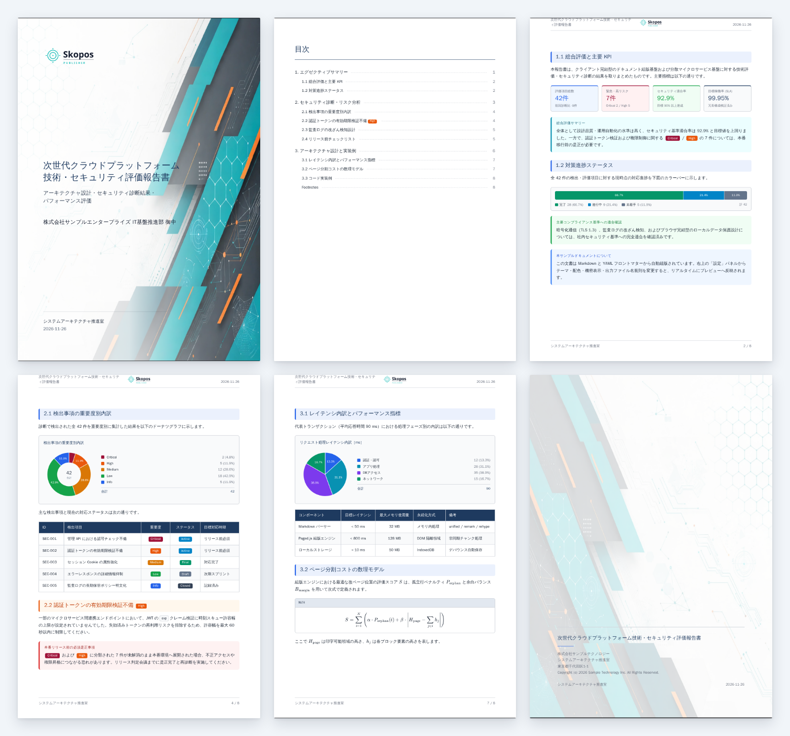
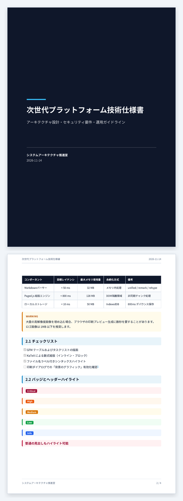
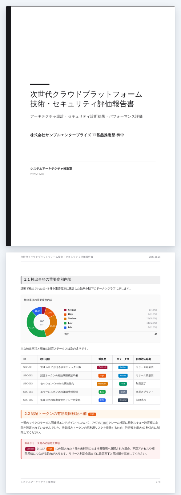

# Skopos Publisher



Markdown と YAML フロントマターから、Paged.js（CSS Paged Media）を用いてビジネス・技術・セキュリティ報告書品質の PDF を生成するクライアント完結型パブリッシング Web アプリケーションです。


## なぜ有用か（特徴とベネフィット）

* **レイアウト作業からの解放**: Word 等での手動レイアウト調整をなくし、Markdown 執筆のまま表紙・章扉・自動ページ番号付き目次・奥付を備えた統一品質の PDF を出力できます。

* **クライアント完結のデータ管理**: 外部 DB や外部 API を持たず、執筆中の複数文書や画像（インライン画像・共通画像ライブラリ）をすべてブラウザの IndexedDB 内に保存します。1 台の社内サーバーをチームで共有しても、利用者間で原稿がサーバーに保存・混在しません。

* **実務レポート向けの表現と運用**: 重要度／ステータスバッジ、7 種類のコールアウト、見出しハイライト、3 段階の機密表示（ヘッダー表記／全面透かし）、複数文書の管理・個別削除・一括初期化に対応しています。

* **既存資産の活用**: ローカルの原稿フォルダ（`.md` ＋画像フォルダ一式）を読み込んで即座に組版・PDF 化でき、ロゴや表紙背景は共通ライブラリから複数文書へ使いまわせます。




### プリセットテーマ別のサンプルレポート

初期搭載されている 3 つのプリセットデザイン（`Business` / `Technical` / `Minimal`）で出力したサンプルレポートの例です。

| Business | Technical | Minimal |
| ----- | ----- | ----- |
|  |  |  |

## 画面構成（UI）

* **トップツールバー**: サイドバー／設定パネル開閉、表示切替（エディタ／分割／プレビュー）、フォルダ／`.md` 読込、`.md` 保存、PDF 出力

* **左サイドバー（折りたたみ式）**: 文書一覧（更新日時・容量確認・新規作成・切替・削除）と共通画像ライブラリ（ロゴ・表紙・裏表紙の登録と適用）

* **中央ペイン**: フォーマット支援バー付き Markdown エディタ ＋ ズーム・見開き表示・ページジャンプ・余白ガイド対応のプレビュー

* **右設定ドロワー**: 用紙サイズ、テーマ、配色、フォント、機密レベル、ヘッダー／フッターを GUI で編集（YAML フロントマターと双方向同期）

## 始め方（Getting Started）

### 前提環境

* **Node.js**: v20 以降（ローカル起動時）

* **推奨ブラウザ**: Google Chrome / Microsoft Edge（最新版）

### ローカル起動

React 19 との依存関係整合のため `--legacy-peer-deps` を指定してインストールします。

```
npm install --legacy-peer-deps
npm run dev

```

ブラウザで `http://localhost:3000` を開いて利用します。本番ビルド検証やテストは以下のコマンドで行えます。

```
npm run build
npm run start
npm test

```

### Docker での起動（standalone）

```
docker build -t skopos-publisher .
docker run -d -p 3000:3000 --name skopos-publisher skopos-publisher

```

### PDF 出力時の印刷設定

「PDF出力 / 印刷」から印刷ダイアログを開いたら、送信先に「PDF に保存」を選び、**「背景のグラフィック」を ON**、ブラウザ標準の「ヘッダーとフッター」を OFF に設定してください。

## ヘルプ・フィードバック

不具合の報告や機能改善の要望は、[GitHub Issues](https://www.google.com/search?q=https://github.com/takeume2/skopos-publisher/issues) までお寄せください。

## メンテナ・コントリビュート

* **メンテナ**: [takeume2](https://github.com/takeume2)

* 改善提案や修正は Issue でのご相談、または Pull Request にてお送りください。詳細な設計資料や仕様書は別途ドキュメントとして管理しています。