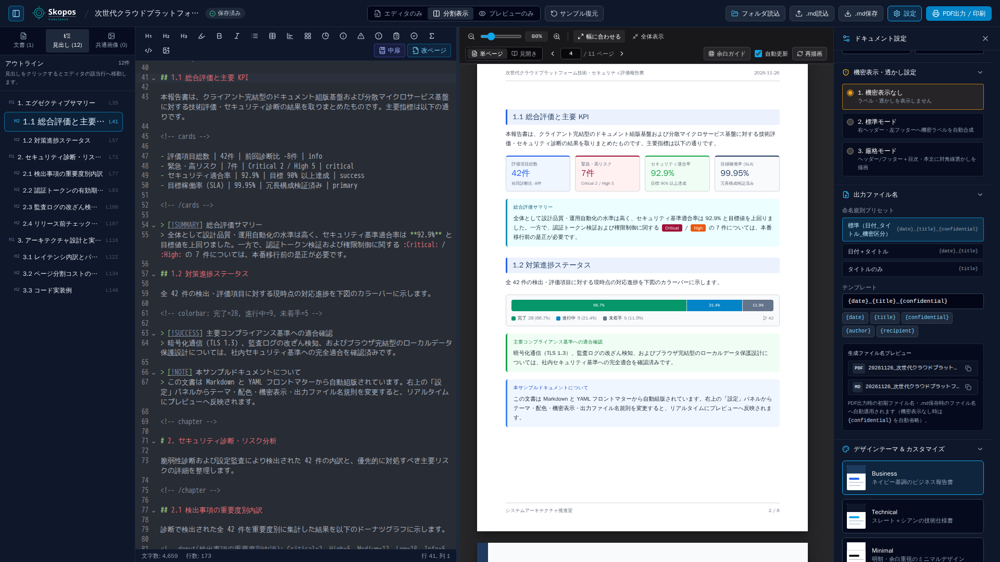
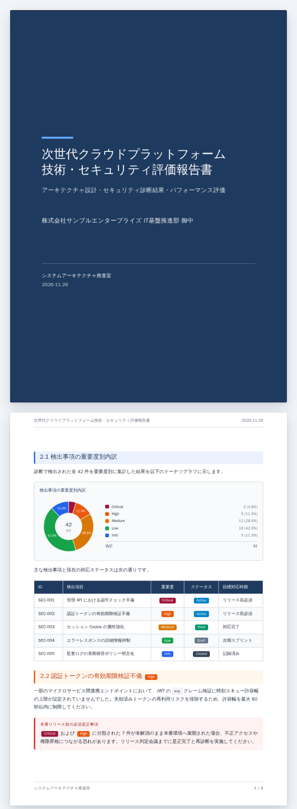

# Skopos Publisher


Markdown と YAML フロントマターから、Paged.js（CSS Paged Media）を用いてビジネス・技術・セキュリティ報告書品質の PDF を生成するクライアント完結型パブリッシング Web アプリケーションです。



## なぜ有用か（特徴とベネフィット）

* **レイアウト作業からの解放**: Word 等での手動レイアウト調整をなくし、Markdown 執筆のまま表紙・中扉（章扉）・自動ページ番号付き目次・奥付（裏表紙）を備えた統一品質の PDF を出力できます。

* **実務レポート向けの表現力**: KPI サマリーカード、カラーバー（割合積み上げ棒）、純 SVG 円／ドーナツグラフ、重要度・ステータスバッジ、見出しハイライト、7 種類のカスタムタイトル対応コールアウト、KaTeX 数式、ファイル名付きコードブロックに対応しています。詳細な記法は [Markdown 記法・YAML フロントマター リファレンス](docs/markdown-guide.md) を参照してください。

* **長文編集・出力を支えるワークフロー**: 左サイドバーの見出しアウトラインからのワンクリック行ジャンプ、ダブルバッファリングによるプレビュースクロール位置保持、エディタへのドロップ座標指定での画像挿入、日付・タイトル・機密区分を含む PDF / Markdown 出力ファイル名の自動生成（プリセット・カスタムテンプレート・コピー対応）を備えています。

* **クライアント完結のデータ管理と安全性**: 外部 DB や外部 API を持たず、執筆中の複数文書・画像（インライン画像・共通画像ライブラリ）・UI 設定をすべてブラウザの IndexedDB 内に保存します。1 台の社内サーバーをチームで共有しても利用者間で原稿が混在せず、厳格な HTML / SVG サニタイズにより安全なプレビュー描画を実現します。

* **既存資産の活用**: ローカルの原稿フォルダ（`.md` ＋画像フォルダ一式）を読み込んで即座に組版・PDF 化でき、ロゴや表紙背景は共通画像ライブラリから複数文書へ使いまわせます。


### プリセットテーマ別のサンプルレポート

初期搭載されている 3 つのプリセットデザイン（`Business` / `Technical` / `Minimal`）で出力したサンプルレポートの例です。

| Business | Technical | Minimal |
| ----- | ----- | ----- |
|  |  |  |

## 画面構成（UI）

* **トップツールバー**: サイドバー／設定パネル開閉、表示切替（エディタのみ／分割表示／プレビューのみ）、サンプル復元、フォルダ／`.md` 読込、`.md` 保存、PDF 出力
* **左サイドバー（折りたたみ式・3 タブ構成）**:
  * **文書**: 複数文書の更新日時・容量確認、新規作成、切替、個別 `.md` 保存、個別削除・一括初期化
  * **見出し（アウトライン）**: Markdown 見出し（`#`〜`######`）の階層一覧、現在カーソル位置ハイライト、クリックでのエディタ行ジャンプ
  * **共通画像**: ロゴ・表紙・裏表紙画像の登録と編集中文書へのワンクリック適用
* **中央ペイン**:
  * **Markdown エディタ**: KPI カード・カラーバー・グラフ・コールアウト・中扉・改ページ等のフォーマット支援バー、ドロップ座標への画像 D&D・クリップボード貼付、行／列ステータス表示
  * **組版プレビュー**: Paged.js によるリアルタイム組版、ズーム・幅に合わせる・見開き表示・ページジャンプ・余白ガイド・スクロール位置保持
* **右設定ドロワー**: 基本・用紙設定、機密表示・透かし設定（3 段階）、**出力ファイル名規則（プリセット／テンプレート編集／PDF・MD プレビュー＆コピー）**、デザインテーマ＆カラー・タイポグラフィ調整、ページ構成（表紙・目次・裏表紙）、ヘッダー／フッター・ロゴ設定（YAML フロントマターと双方向同期）

## ドキュメント

* [Markdown 記法・YAML フロントマター リファレンス](docs/markdown-guide.md) — フロントマター全項目、中扉・KPI カード・カラーバー・円／ドーナツグラフ・バッジ・見出しハイライト・コールアウト・出力ファイル名規則の詳細ガイド

## 始め方（Getting Started）

### 前提環境

* **Node.js**: v20 以降（ローカル起動時）
* **推奨ブラウザ**: Google Chrome / Microsoft Edge（最新版）

### ローカル起動

React 19 との依存関係整合のため `--legacy-peer-deps` を指定してインストールします。

```bash
npm install --legacy-peer-deps
npm run dev
```

ブラウザで `http://localhost:3000` を開いて利用します。本番ビルド検証やテストは以下のコマンドで行えます。

```bash
npm run build
npm run start
npm test
```

### Docker での起動（standalone）

```bash
docker build -t skopos-publisher .
docker run -d -p 3000:3000 --name skopos-publisher skopos-publisher
```

### PDF 出力時の印刷設定

「PDF出力 / 印刷」から印刷ダイアログを開いたら、送信先に「PDF に保存」を選び、**「背景のグラフィック」を ON**、ブラウザ標準の「ヘッダーとフッター」を OFF に設定してください。印刷ダイアログの初期ファイル名には、右設定ドロワーの「出力ファイル名」規則で生成された名称が自動反映されます。
